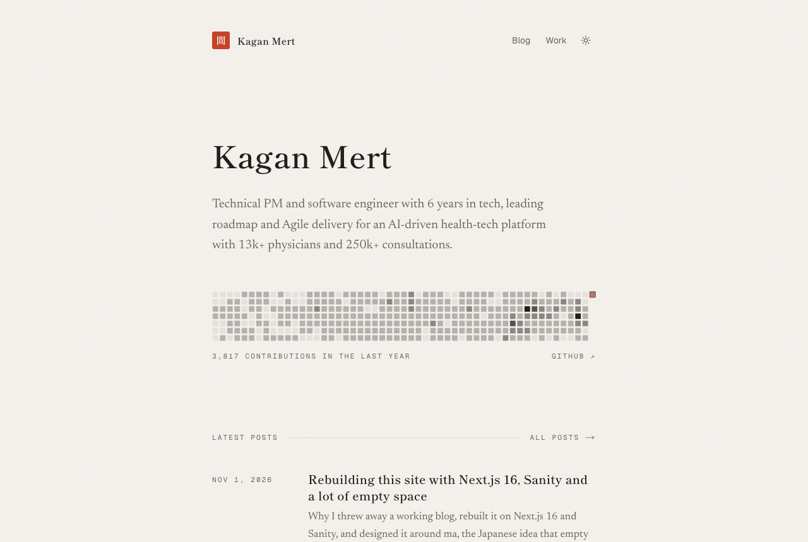
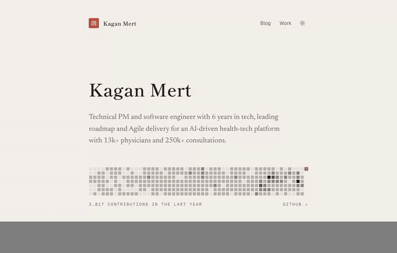

# next-shadcn-sanity-blog

**A calm, typography-led blog and portfolio template for Next.js 16 and Sanity.** Fast static pages that still update the moment you publish, an embedded Studio with Visual Editing, and a design built on _ma_ (間): space does the work.

[](https://github.com/kaganmert/next-shadcn-sanity-blog/actions/workflows/ci.yml)
[](./LICENSE)
[](https://nextjs.org)
[](https://www.sanity.io)

[**Live demo →**](https://kaganmert.com) · [**Deploy with Vercel →**](https://vercel.com/new/clone?repository-url=https%3A%2F%2Fgithub.com%2Fkaganmert%2Fnext-shadcn-sanity-blog&env=NEXT_PUBLIC_SANITY_PROJECT_ID,NEXT_PUBLIC_SANITY_DATASET,SANITY_API_READ_TOKEN&envDescription=Your%20Sanity%20project%20ID%2C%20dataset%20and%20a%20viewer%20token&envLink=https%3A%2F%2Fgithub.com%2Fkaganmert%2Fnext-shadcn-sanity-blog%23local-setup&project-name=my-blog&repository-name=my-blog) · [Customize in 5 minutes](#customize-in-5-minutes)

<picture>
  <source media="(prefers-color-scheme: dark)" srcset="./docs/images/home-dark.png">
  
</picture>

## Features

- **Static and live at once.** Next.js 16 Cache Components prerender every page; Sanity Live revalidates only what changed when you publish. No redeploys.
- **Edit in place.** The Studio lives at `/studio`, with the Presentation tool, click-to-edit overlays and draft previews.
- **Motion with a reason.** Post and project titles morph into their page, routes crossfade with React View Transitions, and the theme fades from paper to ink. Reduced motion keeps only the fades.
- **A real portfolio.** Experience timeline, projects with galleries and update posts, education and awards, a CV download at `/cv.pdf`, and standalone pages like `/privacy`.
- **GitHub contributions.** A year of contributions on the home page as a server-rendered SVG, with GitHub-style day tooltips.
- **Writing that reads well.** Mincho headings, Newsreader body text, server-highlighted code (no highlighter JavaScript), heading anchors.
- **SEO built in.** Metadata, generated OG images, sitemap, robots and an RSS feed.
- **Yours in minutes.** Every name, link and piece of copy lives in Sanity or `lib/strings.ts`, and one color token sets the accent.

<p align="center">
  
</p>

## Stack

| Area        | Choice                                                                        |
| ----------- | ----------------------------------------------------------------------------- |
| Framework   | Next.js 16 (App Router, Cache Components, Partial Prefetching), React 19      |
| Content     | Sanity with an embedded Studio at `/studio`, Live Content API, Visual Editing |
| Styling     | Tailwind CSS v4, shadcn/ui, Shippori Mincho, Newsreader, Geist Sans and Mono  |
| Code blocks | Shiki, highlighted on the server (no highlighter JavaScript in the browser)   |
| Tooling     | pnpm, Node.js 24, TypeScript, Biome, Vitest, Sanity TypeGen                   |
| Hosting     | Vercel, with Web Analytics and Speed Insights                                 |

## Routes

| Route                                     | What it shows                                                         |
| ----------------------------------------- | --------------------------------------------------------------------- |
| `/`                                       | Intro from Settings, GitHub contributions and the latest posts        |
| `/blog`                                   | All posts, newest first, with category links                          |
| `/blog/[slug]`                            | A post: Portable Text body, code blocks, cover and author             |
| `/blog/category/[slug]`                   | Posts in one category                                                 |
| `/work`                                   | Experience, projects, education, awards, organizations and tech stack |
| `/work/[slug]`                            | A project with a gallery: story, screenshots, links and update posts  |
| `/[slug]`                                 | A standalone page, such as `/privacy` or `/support`                   |
| `/cv.pdf`                                 | Redirects to the resume uploaded in Settings                          |
| `/studio`                                 | Embedded Sanity Studio                                                |
| `/rss.xml`, `/sitemap.xml`, `/robots.txt` | Feed and SEO files                                                    |

## Local setup

Requirements: Node.js (the version in `.nvmrc`) and pnpm (`corepack enable`).

1. Install dependencies:

   ```sh
   pnpm install
   ```

2. Create a Sanity project and dataset. If you don't have one yet:

   ```sh
   pnpm exec sanity login
   pnpm exec sanity projects create "my-blog" --dataset production --dataset-visibility public
   ```

3. Copy `.env.example` to `.env.local` and fill in `NEXT_PUBLIC_SANITY_PROJECT_ID` and `NEXT_PUBLIC_SANITY_DATASET`.

4. Create a viewer token for draft mode and Visual Editing, then put it in `SANITY_API_READ_TOKEN`:

   ```sh
   pnpm exec sanity tokens add "next-app-viewer" --role viewer
   ```

5. Let the local Studio sign in:

   ```sh
   pnpm exec sanity cors add http://localhost:3000 --credentials
   ```

6. Optionally, import the sample content (Settings, an author, categories, posts and experiences). See [`sanity/seed/README.md`](./sanity/seed/README.md).

   ```sh
   pnpm seed
   ```

   `pnpm seed` imports into the `production` dataset with `--replace`, so it overwrites documents that have the same IDs.

7. Start the dev server. The site runs on <http://localhost:3000> and the Studio on <http://localhost:3000/studio>.

   ```sh
   pnpm dev
   ```

## Scripts

| Command          | What it does                                               |
| ---------------- | ---------------------------------------------------------- |
| `pnpm dev`       | Start the dev server                                       |
| `pnpm build`     | Production build                                           |
| `pnpm start`     | Serve the production build                                 |
| `pnpm lint`      | Biome lint + format check                                  |
| `pnpm format`    | Apply Biome fixes and formatting                           |
| `pnpm typecheck` | Generate route types and run tsc                           |
| `pnpm test`      | Run the Vitest suite                                       |
| `pnpm typegen`   | Extract the Sanity schema and regenerate `sanity.types.ts` |
| `pnpm seed`      | Import the sample content in `sanity/seed`                 |

CI (`.github/workflows/ci.yml`) runs lint, typecheck, tests and build on every pull request and on pushes to `master`.

## Environment variables

| Name                            | Where                         | Notes                                                            |
| ------------------------------- | ----------------------------- | ---------------------------------------------------------------- |
| `NEXT_PUBLIC_SANITY_PROJECT_ID` | `.env.local`, Vercel, CI vars | Public                                                           |
| `NEXT_PUBLIC_SANITY_DATASET`    | `.env.local`, Vercel, CI vars | Public, usually `production`                                     |
| `SANITY_API_READ_TOKEN`         | `.env.local`, Vercel (secret) | Viewer token, server-only; enables draft mode and Visual Editing |
| `NEXT_PUBLIC_SITE_URL`          | Optional                      | Canonical URL; on Vercel it defaults to the production domain    |
| `GITHUB_TOKEN`                  | Optional, server-only         | Shows GitHub contributions on the home page (see below)          |

`.env.example` lists the same variables. The build never needs the token, so CI only sets the two public values (as repository variables).

## Content model

- `settings` (singleton): site name, description, home intro, navigation, social links, GitHub username, resume PDF, tech stack
- `post`: title, slug, excerpt, cover image, author, categories, published date, Portable Text body
- `project`: name, dates, status, description, tech stack, links, icon, gallery and an updates category
- `credential`: education, awards, certificates and organizations
- `page`: a standalone page at `/[slug]`
- `category`, `author`, `experience`

Schemas live in `sanity/schemaTypes`, and GROQ queries live in `sanity/lib/queries.ts`. Every query uses `defineQuery`, and TypeGen types them. Run `pnpm typegen` after changing either.

## Editing and previews

- Published content changes appear on the live site without a redeploy (Sanity Live).
- In the Studio, open **Presentation** to edit with click-to-edit overlays. Drafts show only in draft mode. Outside Presentation, an "Exit draft mode" banner appears.

## Deploying to Vercel

1. Import the repository in Vercel and set the project's Node.js version to 24.x (`vercel project update <name> --node-version 24.x`). `engines.node` in `package.json` pins it too.
2. Add the environment variables above for Production, Preview and Development, so `vercel env pull` works locally. Mark `SANITY_API_READ_TOKEN` as sensitive for Production and Preview; sensitive variables can't target Development, so add it there as a normal variable.
3. Add your Vercel domains to Sanity CORS with credentials, for example `https://your-app.vercel.app` and `https://your-app-*-your-team.vercel.app` for previews.
4. Optionally, turn on Web Analytics and Speed Insights for the project. The components are already in the site layout.

## Customize in 5 minutes

Everything personal lives in Sanity or in one of three files, so making the template yours is mostly editing, not coding.

1. **Identity and copy.** In the Studio, open **Settings**: site name, description, home intro, navigation, social links, tech stack, GitHub username and resume. Then add your experience, projects and posts.
2. **Accent color.** Change `--primary` in `app/globals.css` (one value for light, one for dark). It is the only accent: the seal, link underlines, focus rings and small markers.
3. **Typefaces.** Swap the `next/font` imports in `app/layout.tsx`. `--font-mincho` sets headings, `--font-newsreader` sets reading text, and Geist sets the UI.
4. **UI strings.** Translate or rewrite them in `lib/strings.ts`. Every string that isn't content lives there.
5. **The seal.** Change the character in `components/seal.tsx`.

### GitHub contributions

Set **GitHub username** in Settings, and add `GITHUB_TOKEN` to `.env.local` and Vercel. A [fine-grained token](https://github.com/settings/personal-access-tokens/new) with no permissions is enough, because it only reads public data. Without either value, the graph doesn't render.

## License

See [LICENSE](./LICENSE).
